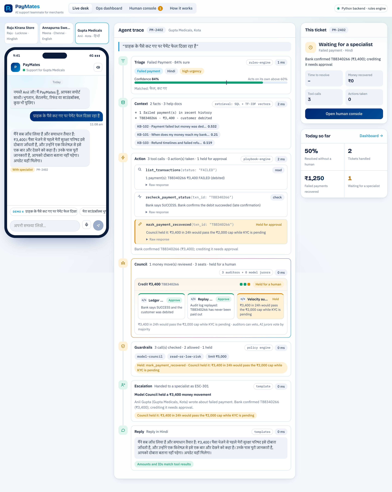
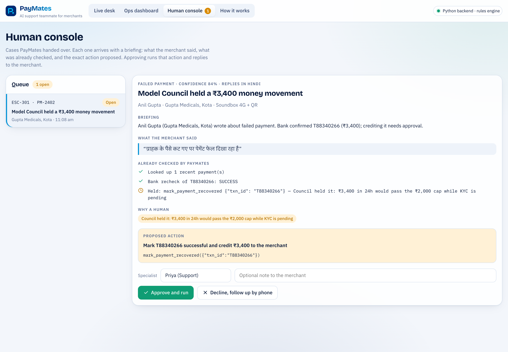
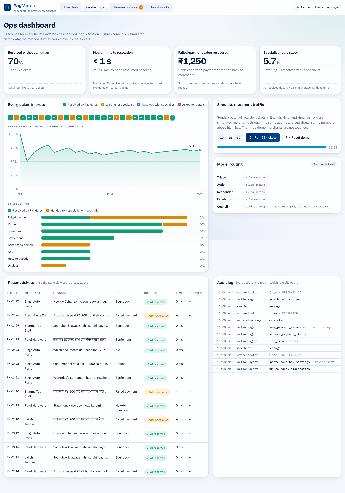

# PayMates

**An autonomous AI support teammate for merchants.** It understands the problem, decides what to do, takes action through guarded tools, and brings in a human only when it matters.

Built for **Paytm Build for India AI Hackathon — Track 3: Autonomous AI Teammates** (Delhi-NCR finale).



---

## Run it (2 minutes)

You need Python 3.10+. Node is **not** needed: the web app is already built into `frontend/dist`.

```bash
./run.sh
```

Then open **http://localhost:8000**.

Without any API keys, PayMates runs on its built-in rules engine, so the demo works even with no internet. To switch the agents onto real models, see [Add AI models](#add-ai-models).

**Windows, or doing it by hand:**

```bash
python3 -m venv .venv && source .venv/bin/activate      # Windows: .venv\Scripts\activate
pip install -r backend/requirements.txt
cd backend && uvicorn app.main:app --port 8000
```

**Run the tests:** `cd backend && python3 -m pytest -q` (40 end-to-end tests).

---

## What you'll see

| View | What it shows |
|---|---|
| **Live desk** | Left: the merchant's phone chat (English, हिन्दी, Hinglish), with optional Soundbox-style voice replies a **PayMates check-in** button that finds and fixes problems before the merchant asks, and a **₹ Today's hisaab** chip: one message with today's UPI received (already in the bank), card/wallet pending (next working day) and what PayMates fixed, in the merchant's language. Every check-in ends with it. Centre: the **agent trace**, where each agent lights up live with the model it used, every tool call, the guardrail verdict, and timings. Right: the ticket outcome and today's scoreboard. |
| **Ops dashboard** | The outcome metrics (including **Fixed before the merchant asked**), an **ROI calculator** (editable example assumptions → monthly/yearly savings in lakh/crore and specialist hours freed), a ribbon of every ticket coloured by outcome, the cumulative AI-resolution line, results by issue type, a traffic simulator, the model routing table, recent tickets and the audit log. |
| **Human console** | The **Autonomy level** dial (Suggest only · Low · Standard), then escalated cases with a full briefing: what the merchant said, what PayMates already checked, why a human is needed, the exact action proposed, and any **similar past decision** a specialist made. **Approve and run** executes it and messages the merchant. |
| **How it works** | Architecture (including the proactive Watcher), model routing, guardrails, the **Accuracy** test (45 labelled messages in English, Hindi and Hinglish), tech stack. |

| Human console | Ops dashboard |
|---|---|
|  |  |

---

## Finale demo script (about 3 minutes)

> Before you start: open the app, go to **Ops dashboard → Reset demo**, then return to **Live desk**. Turn on the speaker icon in the phone if the room has sound.

1. **Hook (15s).** "Paytm said it best: a chatbot answers questions, a teammate closes the loop. Meet Raju, a kirana owner in Lucknow. It's 9 PM, his shop is full, and money is stuck. Watch what happens when he messages PayMates."

2. **Demo 1: Failed payment (40s).** Raju's phone → tap **Demo 1** ("Customer's payment failed but money was deducted").
   Point at the trace: *Triage* reads it, *Context* pulls his failed payments, *Action* **rechecks with the bank**, the bank confirms late success, and PayMates **credits ₹1,250 back**. The *Guardrails* line shows why it was allowed: under ₹5,000 and bank-confirmed.
   Say: "It didn't answer a question. It recovered money."

3. **Demo 2: Hinglish settlement (30s).** Tap **Demo 2** ("Kal ka settlement nahi aaya").
   It replies in Hinglish, finds the settlement held by a bank timeout, **re-sends ₹18,640 to his verified account**, and opens a tracking ticket.

4. **Demo 3: Knows its limits (50s).** Switch to **Annapurna Sweets** → **Demo 3** ("Customer says refund not received").
   The ₹7,800 refund bounced. PayMates tries to re-send it, but the **guardrail holds it** (above ₹5,000). The trace shows the hold, and Escalation writes a briefing.
   Click **Open human console**: everything is pre-checked. Click **Approve and run**. Go back to the Live desk and show Meena's chat: the specialist's update is already there.
   Say: "Autonomy with guardrails is what makes a teammate safe to hire."

5. **PayMates check-in: fixes it before Anil asks (60s).** Switch to **Gupta Medicals** and click **PayMates check-in** on the phone. Anil hasn't typed anything.
   The **Watcher** step lights up first, then each problem runs through the same agents and guardrails, and each message opens with "मैंने देखा कि…" ("I noticed…") in Hindi, with a **PayMates noticed** badge:
   - **₹860** payment failed but the customer was charged → bank recheck → **recovered**.
   - **₹3,400** payment, same story, but the **Model Council holds it**: KYC is pending, so the autonomous cap is ₹2,000 a day. It goes to the Human console with every reviewer's reason.
   - **₹9,415** settlement held for KYC → guides Anil on the missing documents and opens a fast-track ticket. No money is forced through.
   - **Soundbox** on mute with a weak signal → PayMates moves it to the backup network remotely, and asks Anil to press **+** three times (volume is a physical button; it never pretends otherwise).
   The check-in ends with **today's hisaab** in Hindi: UPI received, card money arriving tomorrow, and "₹860 का अटका भुगतान वापस".
   Click **PayMates check-in** again: "all clear", and nothing is fixed twice.
   Say: "Guardrails ask 'is this allowed?' The council asks 'is this safe right now?' And the best support ticket is the one the merchant never had to raise."

6. **Ops controls the autonomy (30s).** **Human console → Autonomy level → Suggest only.** Back on Raju's phone, send Demo 1 again after **Reset demo**, or any failed payment: PayMates does all the checks but the ₹1,250 credit now waits in the console ("waiting for approval (autonomy level)"). Switch back to **Standard**. The header pill always shows the level, and every change is in the audit log.
   Say: "Paytm doesn't have to trust AI with money on day one. Ops turns the dial."

7. **Scale and ROI (40s).** **Ops dashboard → Run 25 tickets.** The ribbon and metrics fill live: resolution rate, money recovered, hours saved, and **Fixed before the merchant asked** (proactive tickets have a blue dot in the ribbon).
   Scroll to the **ROI calculator**: the resolution rate follows the live dashboard; at 1 lakh tickets a month the example assumptions show savings in lakh/crore. Say clearly that the inputs are example assumptions, not Paytm data.
   If you approved Demo 3 earlier, open the Human console: simulated refund escalations show **"Similar past decision: Priya approved re-sending a ₹7,800 refund (ESC-301)"**. PayMates learns from its humans.
   Say: "Same agents, same guardrails, six simulated merchants, three languages."

8. **Close (15s).** "Support that feels like a teammate, not a ticket number. Let's get Raju home on time."

**Optional (if asked about accuracy):** **How it works → Run accuracy test.** 45 labelled messages, accuracy per language and which model answered. Be upfront: the rules engine scored 84% before its keywords were tuned on this set, so today's score is an upper bound.

**If something breaks on stage:** the app automatically falls back to the in-browser engine if the backend stops, and every model call falls back to rules if a provider is slow. Set `PAYMATES_MODE=offline` in `.env` for a fully offline, fully predictable run.

---

## Add AI models

Copy `.env.example` to `.env` and add any keys you have. **Each agent gets the provider that suits its job**, and anything missing falls back to rules.

| Agent | Job | Preferred providers (first available wins) |
|---|---|---|
| Triage | Classify the message fast, extract IDs | Groq (Llama 3.1 8B) → Gemini Flash → GPT-4.1 mini → Claude Haiku |
| Action | Plan and call tools in a loop | Claude Sonnet → GPT-4.1 → Gemini Pro → Groq Llama 70B |
| Responder | Warm reply in Hindi/Hinglish/English | Gemini Flash → GPT-4.1 mini → Claude Haiku |
| Escalation | Two-sentence briefing for a human | Claude Haiku → GPT-4.1 mini → Gemini Flash |

- **Cheapest strong setup:** `GROQ_API_KEY` + `GEMINI_API_KEY` (both have free tiers).
- **All of them:** add `OPENAI_API_KEY` and `ANTHROPIC_API_KEY` too. The header pill and the dashboard's *Model routing* panel show which model each agent is using.
- **Pin a model:** `PAYMATES_ACTION_MODEL=anthropic:claude-sonnet-5-5`. Model names change over time, so check your provider dashboard if a call fails. The trace shows `fallback from …` when that happens.
- **Local model:** `OLLAMA_ENABLED=true` (after `ollama pull llama3.1`).

The LLM path, including multi-step tool calling, has been tested against mock OpenAI-format and Anthropic-format servers. Plug in real keys and run one message of each demo before the finale.

---

## The Model Council (what makes PayMates different)

Before **any** money moves without a human, the action goes to a council that reviews it in parallel ([backend/app/council.py](backend/app/council.py)):

| Seat | Kind | Checks | Power |
|---|---|---|---|
| Ledger auditor | code | Re-reads the evidence straight from the records | Veto |
| Replay auditor | code | Replays the audit log to catch a double payout | Veto |
| Velocity auditor | code | Risk-tiered daily cap: ₹25,000 per merchant, ₹2,000 while KYC is pending (credits and refunds only) | Veto |
| One juror per configured provider | model | Claude, GPT, Gemini, Llama (Groq), OpenRouter, Ollama each vote APPROVE / HOLD with a reason | Majority |

A juror that times out **abstains**, so a flaky provider never stalls a ticket. A HOLD becomes an approval request in the human console, with every seat's reason. A human approval overrides the council. Every review is written to the audit log.

---

## How it works

```
Merchant chat (EN / हिन्दी / Hinglish)      Watcher (PayMates check-in)
        │  every message becomes a ticket      │  every problem found in the records becomes a ticket
        └──────────────────┬───────────────────┘
                           ▼
┌──────────────── Orchestrator (streams every step over SSE) ────────────────┐
│ [Watcher] ─► Triage ─► Context ─► Action ─► [Council] ─► [Escalation] ─► Reply │
└──────────────────────────────┬─────────────────────────────────────────────┘
                               │  every tool call passes the guardrails first
        ┌──────────────┬───────┴────────┬────────────────┐
     Tools (mock     Knowledge       Memory          Guardrails +
     Paytm APIs)     (help-center    (history,       audit log
                      RAG)            past tickets)
```

**Tools the agent can call:** `list_transactions`, `get_transaction`, `recheck_payment_status`, `mark_payment_recovered`, `list_settlements`, `retry_settlement`, `list_refunds`, `get_refund`, `reinitiate_refund`, `get_kyc_status`, `run_soundbox_diagnostics`, `reconnect_device`, `resend_missed_announcements`, `set_announcement_language`, `play_test_announcement`, `raise_ticket`, `search_help_center`, `escalate_to_human`.

**Autonomy dial:** `GET/POST /api/policy` sets `autonomy_level` (`suggest` · `low` · `standard`, default `standard`). Guardrails read it at call time in both engines; `raise_ticket` and Soundbox actions stay allowed at every level. **Daily hisaab:** `POST /api/merchants/{id}/hisaab`. **Accuracy:** `GET /api/evals` runs `shared/evals.json` through triage. **Learning:** approvals and declines are stored and recalled in similar briefings.

**Proactive Watcher:** the **PayMates check-in** scans one merchant's records for failed-but-charged payments, held settlements, bounced refunds and Soundbox issues. Each finding runs through the same orchestrator, tools, guardrails and council as a chat message (ticket source `proactive`), and the reply opens with an outbound "I noticed…" in the merchant's language. It is idempotent: records that already have an open escalation, or that PayMates already worked on, are skipped. API: `POST /api/merchants/{id}/checkin` (same SSE events as `/api/chat`).

**Guardrails (enforced in code, not in the prompt):**
- **Confidence:** below 60% triage confidence → escalate instead of guessing.
- **Money limit:** refunds/credits above ₹5,000 are held for human approval.
- **Evidence:** a failed payment is credited only after the bank confirms it.
- **Retry rules:** only `BANK_TIMEOUT` holds are retried, and only to the same verified account.
- **Scope:** the agent can only touch records of the merchant it is serving.
- **Grounded replies:** a model's rewrite is sent only if every ₹ amount and ID matches the tool results.
- **Privacy:** phones, UPI IDs and account numbers are masked before logs or model calls.
- **Model Council:** money moves also need the council's approval (see above).
- **Audit:** every action is logged with who did it and which rule allowed it.

---

## Tech stack

| Layer | Choice |
|---|---|
| Agents & API | Python 3, FastAPI, async orchestrator, Server-Sent Events |
| Models | OpenAI, Anthropic Claude, Google Gemini, Groq, OpenRouter, Ollama. Two adapters (OpenAI-compatible + Anthropic Messages) cover all six; per-agent routing; rules fallback |
| Tool calling | Native function calling / tool use, normalised to one internal format |
| RAG | TF-IDF vector index + cosine similarity over the help center; Hinglish/Hindi synonym expansion |
| Data | SQLite (merchants, payments, settlements, refunds, tickets, escalations, audit); plain SQL, ports to PostgreSQL |
| Web | React 18, Vite, hand-built SVG charts, Web Speech API (voice replies + mic input) |
| Prototype | The same agent logic in JavaScript (`frontend/src/engine/local.js`) so the app runs fully in the browser; optional Claude-driven mode |
| Model Council | Parallel review with `asyncio.gather`; code auditors with veto + cross-provider model jurors; abstain on timeout |
| Tests | pytest end-to-end scenarios, guardrails, council votes, simulation, LLM-failure fallback (40 tests) |

---

## Project structure

```
paymates/
├── run.sh                    one-command start
├── .env.example              API keys and options
├── shared/                   used by BOTH engines, so they behave identically
│   ├── seed.json             simulated merchants, payments, settlements, refunds, help center
│   ├── lexicon.json          Hinglish/Hindi keywords, synonyms, simulation messages
│   ├── templates.json        reply templates in English, Hindi, Hinglish
│   └── evals.json            45 labelled messages for the accuracy test
├── backend/
│   ├── app/
│   │   ├── main.py           FastAPI routes + SSE + serves the web app
│   │   ├── config.py         providers and per-agent model routing
│   │   ├── llm/__init__.py   OpenAI-compatible + Anthropic adapters
│   │   ├── agents/           triage, context, action, escalation, responder, orchestrator
│   │   ├── tools.py          mock Paytm merchant APIs + ToolRunner
│   │   ├── guardrails.py     policy checks + PII masking
│   │   ├── council.py        Model Council: auditors + cross-provider jurors
│   │   ├── watcher.py        proactive check-in: finds problems before the merchant asks
│   │   ├── hisaab.py         daily hisaab summary
│   │   ├── evals.py          triage accuracy on shared/evals.json
│   │   ├── rag.py            help-center vector search
│   │   ├── store.py          SQLite store
│   │   └── ops.py            metrics, human console, simulator
│   └── tests/test_scenarios.py
└── frontend/
    ├── src/App.jsx, components/, engine/ (remote.js = backend client, local.js = in-browser engine)
    └── dist/                 pre-built app served by the backend
```

Rebuild the web app after UI changes: `cd frontend && npm install && npm run build` (and `npm run build:artifact` for the single-file prototype).

---

## Questions judges are likely to ask

**"Is this just a chatbot?"** No. Open the trace: it calls tools that change state (credits a payment, re-sends a settlement, reconnects a Soundbox, opens a ticket), and the check-in finds problems before the merchant even asks. The dashboard measures outcomes, not messages.

**"What stops it from moving money it shouldn't?"** Guardrails run in code before every tool call, whatever the model says. When the model tried to re-send ₹7,800, the guardrail held it and created the approval request. Show the audit log.

**"What if the model hallucinates?"** Amounts and IDs only come from tool results. A model's reply is checked against them, and if anything doesn't match, the verified template is sent instead.

**"What if the LLM is down or slow?"** Each step falls back to the rules engine and the ticket still closes. The trace says `fallback`.

**"Why several models?"** Each job suits a different model. Fast and cheap for triage, the strongest tool-caller for actions, a good multilingual writer for replies. Routing is config, so Paytm can swap in its own models.

**"How does it work with real Paytm systems?"** The tools have the same shape as merchant-support APIs (transactions, settlements, refunds, KYC, device management). In production they would call Paytm's internal services instead of the demo database.

**"Are these numbers real?"** No, and say so: all data is simulated. The point is the method. The same four metrics, computed the same way, can be rerun on real tickets. The 18-minute manual baseline is an assumption, labelled as one in the app.

**"Would Paytm trust AI with money?"** It doesn't have to on day one. Ops controls the autonomy level in the Human console: at **Suggest only**, every money action needs a human, and PayMates still does the checking, explaining and ticketing. **Low** allows up to ₹1,000, **Standard** up to ₹5,000. Every change is audited, and the Model Council plus guardrails apply at every level.

**"How accurate is it?"** How it works → **Run accuracy test**: 45 labelled merchant messages (15 English, 15 Hindi, 15 Hinglish, messy spelling included), with accuracy per language and which model answered. The rules engine scored 84.4% before we tuned its keywords on this set, so its current score is an upper bound; with API keys set, the same test measures the configured model. The next step is a held-out set from real tickets.

**"Does it get better over time?"** Every specialist decision is stored. When a similar case arrives (same issue, amount within 50%), its briefing shows "Similar past decision: Priya approved re-sending a ₹7,800 refund (ESC-301)", so humans stay consistent and the cases worth automating become obvious.

**"What's the business case?"** Lower support cost per ticket (most tickets close without a human), money recovered for merchants (failed-but-charged payments credited back the same day), and better retention of Soundbox subscription merchants, because problems get fixed before they turn into complaints. The ROI numbers in the app are example assumptions; plug in real ones.

**"How would you roll this out?"** Phase 1: read-only checks and answers (status, explanations, guidance). Phase 2: low-risk actions under ₹5,000 with guardrails and the council. Phase 3: wider actions with human approval and a full audit trail. Each phase is a config change, not a rewrite.

**"How does it integrate with Paytm?"** Through the same tool interface. Swap the mock tools for Paytm's internal APIs (transactions, settlements, refunds, KYC, device management); the agents, guardrails and council don't change.

**"Can it really fix a Soundbox remotely?"** Only what a connected device allows: status and diagnostics, reconnect (and move to a backup network), re-announce missed payments, change the announcement language, play a test. Physical things like the volume button get guided steps ("press + three times"); hardware faults or long outages get a technician.

**"Hindi support?"** Language is detected by script and Hinglish markers. Replies come back in the same language, and voice replies use Indian English or Hindi voices.

---

## About the data

All merchants, payments, settlements and refunds are simulated, and the help-center articles are sample policies written for this prototype, not official Paytm documents.
